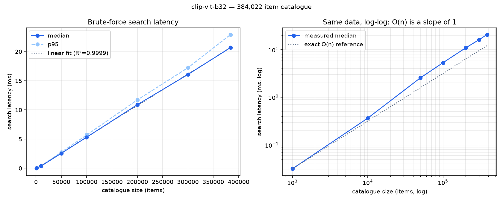

# Visual Search — Architecture

Upload a photo, get back visually similar catalogue items with a plain-English
reason for each. Built on a 384,022-image subset of
[epishchik/RuFashion-2M](https://huggingface.co/datasets/epishchik/RuFashion-2M),
served from a FastAPI endpoint on an M2 Pro.

---

## 1. What was built

```
parquet shard ──► catalogue ──► embeddings ──► index ──► API ──► ranked results
                 (images +      (CLIP-style   (matrix   (FastAPI)  + explanations
                  metadata)      encoder)      + ids)
```

| Stage | Script / module | Output |
|---|---|---|
| Download one ~1 GB shard | `scripts/1_download_shard.py` | `data/raw/*.parquet` |
| Inspect schema and images | `scripts/2_explore_dataset.py` | sample JPEGs |
| Extract images + metadata | `scripts/3_build_catalogue.py` | `data/catalogue/` |
| Compare embedding models | `scripts/4_bakeoff.py` | HTML contact sheet |
| Build the index | `scripts/5_build_index.py` | `data/index/<model>/` |
| Query from the terminal | `scripts/6_search.py` | ranked list |
| Stage-by-stage latency | `scripts/7_benchmark_latency.py` | `metrics/bench/` |
| Latency vs catalogue size | `scripts/8_benchmark_scaling.py` | `metrics/scaling/` |
| Serve | `app/` | `POST /search/` |

The index is a plain `float32` matrix of L2-normalised rows, stored as
`embeddings.npy` with a parallel `ids.npy` and a `manifest.json`. Deliberately
not a library-specific format: the same array loads straight into
`faiss.IndexFlatIP.add()` when brute force runs out, so scaling up is an
implementation change inside one method rather than a rewrite.

---

## 2. Design decisions, and why

### Embedding model: a bake-off, not a guess

Three candidates were indexed over the same catalogue and judged against the
same held-out queries from the dataset's **test** split (never the train shards
the catalogue came from).

| Model | Dim | Build throughput | Preprocessing | Index size (384k) |
|---|---|---|---|---|
| `openai/clip-vit-base-patch32` | 512 | 235 img/s | resize + centre crop | 786 MB |
| `Marqo/marqo-fashionCLIP` | 512 | 99 img/s | resize + centre crop | 786 MB |
| `Marqo/marqo-fashionSigLIP` | 768 | 94 img/s | squash to 224×224 | 1,180 MB |

On a 20-query eye check at 4k, category-match@5 was 75 / 75 / 80 % — too close
to call on that sample size, so the decision rested on the contact sheets in
`metrics/bakeoff/`. SigLIP is the default (`EMBEDDING_MODEL` in `.env`); the
other two remain one config line away, with their indexes already built.

The preprocessing difference is real and is recorded per index: CLIP centre-crops
(keeps aspect ratio, discards the edges of a tall product shot), SigLIP squashes
(distorts aspect ratio, keeps the whole garment).

### One embedder interface, two backends

Everything reaches a model through `Embedder`: `embed_images`, `embed_texts`,
`describe`. The registry maps a name to a checkpoint and a backend class.

This stopped being academic when `transformers` 5 broke the Marqo checkpoints —
it initialises weights on the `meta` device, and Marqo's `trust_remote_code`
module builds an `open_clip` model inside `__init__`, which fails with
`Cannot copy out of meta tensor`. Loading those two through `open_clip`
directly fixed it, and the change was one new class plus a registry key.
`4_bakeoff.py`, `5_build_index.py` and the API never learned that two loaders
exist.

### Vectors are normalised at the source

Every embedder returns unit-length rows. Cosine similarity is then exactly a
dot product, so retrieval is one matrix multiply with no per-query division,
and the index is directly compatible with FAISS's inner-product index.

### The manifest, and refusing to run on a mismatch

Each index records the model id, the resolved **commit hash**, embedding
dimension, preprocessing method, whether vectors are normalised, item count,
which shards the catalogue came from, when it was built, and how long it took.

At startup `Retriever.open` compares the configured model against that manifest
and **refuses to start** if the id, revision, dimension or preprocessing differ.
Comparing a CLIP query vector against a SigLIP matrix produces numbers, not
answers — every result would be silently wrong and nothing would raise. The
check costs microseconds.

There is no random seed to record because there is no sampling: each shard
contributes its first rows in shard order. That is stronger than a seed — it is
exactly reproducible — and it is sound because the shards are pre-shuffled,
verified by comparing the category distribution of a 4k prefix against its full
60k shard (t-shirts 11.0 % vs 11.0 %, dresses 4.1 % vs 4.3 %).

### Load once, serve many

The FastAPI lifespan loads the model onto MPS, reads the matrix and metadata
into memory, and runs two warm-up queries. Loading costs ~10 s; a query costs
tens of milliseconds. The warm-up is not ceremony — measured cold, the first
search ran 15× slower than steady state (first touch of the matrix faults it
into memory, and the first forward pass allocates GPU buffers).

If loading fails the API still starts, and `/search` returns 503 with the
reason rather than the process dying.

---

## 3. The API contract

```
POST /search/              multipart: image (file), top_k (1–50, default 10), explain (bool, default true)
GET  /search/images/{id}   the catalogue image referenced by image_url
GET  /search/info          loaded model, revision, preprocessing, device, catalogue size
GET  /docs                 OpenAPI schema
```

Multipart because browsers, curl and Postman all do it natively — no base64
wrapper around binary. `top_k` is **clamped** rather than rejected: asking for
4,000 results returns 50 and echoes `top_k: 50`, which is friendlier than a 400
and still bounds the work.

```json
{
  "query": { "top_k": 5, "explain": true },
  "model": "Marqo/marqo-fashionSigLIP",
  "catalogue_size": 384022,
  "results": [
    { "rank": 1, "item_id": "000025", "image_url": "/search/images/000025",
      "category": "Сари", "colors": ["розовый", "коричневый"], "similarity": 0.8876,
      "explanation": "A very close match for your photo, in the same pink and brown tones: long sari in silk." }
  ],
  "timings_ms": { "preprocess": 0.53, "embed": 24.21, "search": 12.72, "explain": 0.05, "total": 37.51 }
}
```

The response serves three readers at once: a frontend (`image_url`, `category`,
`colors`), a non-technical stakeholder (`explanation`), and an engineer
(`timings_ms`). No score, distance or model internal appears inside the
explanation text.

`GET /search/images/{id}` resolves the file path **from the catalogue table by
ID**, never from the request string, so path traversal cannot work by
construction (`/search/images/../../etc/passwd` → 404).

---

## 4. Explanations: grounded by construction

Every explanation is assembled **in code** from measured signals. The structure
is fixed, so each clause corresponds to something observed:

| Clause | Where it comes from |
|---|---|
| "A very close match" | similarity bucketed into words — the number never leaves the server |
| "in the same pink and brown tones" | colours measured from the query pixels ∩ the item's annotations |
| "long", "fitted" | the dataset's annotations, closed vocabulary |
| "in silk" | the dataset's annotations |
| "sari" | LLM translation of the Russian category name |

Query colours are measured by snapping pixels to the dataset's own 13-colour
vocabulary — so a measured colour and an annotated one are directly comparable —
and only the **centre half** of the frame is sampled, because these are studio
shots where the full-frame dominant colour is the backdrop.

The query's category comes from zero-shot classification: the image vector is
compared against text embeddings of the 150 most common category names. That is
the model's own judgement about the photo, not the retrieved item's label, which
would make the comparison circular. It reuses the vector already computed, so it
costs one dot product.

### What the LLM does, and why only that

**Ollama (`llama3.2:1b`) translates the category name. Nothing else.**

That is a deliberate retreat. Letting the 1b model write the whole sentence was
tried and failed in both directions:

- Loose validation accepted invented detail — *"blue denim jeans with brown and
  pink stripes"* for a sari.
- Strict validation rejected 11 of 12 outputs **and still passed the worst one**
  — *"The plush cushion... soft pink background with subtle black accents"* for
  an item that was swimwear.

No regex reliably separates a 1b model's good output from its bad. Narrowing the
job to a two-word translation makes the task small enough for the model and the
output easy to check (leftover Cyrillic, digits, a sentence instead of a name,
length, refusals). An invented claim is now structurally impossible rather than
filtered after the fact.

Translations are cached per process, so the cost is paid once per distinct
category: **~190 ms on a miss, 0.05 ms on a hit.** If Ollama is unreachable or
disabled (`EXPLAIN_WITH_LLM=false`), explanations still work with the category
in its original Russian — observed in practice when the Ollama server died
mid-session and the endpoint kept serving.

**Known limitation:** `llama3.2:1b` mistranslates roughly a quarter of
categories — `косметичка` (makeup bag) → "Face Cream", `светильник` (lamp) →
"Light Bulb". No check catches a confidently wrong translation; it is
well-formed English of the right length. `llama3.2:3b` fixes most of these.

---

## 5. Complexity and scaling

### Time complexity

A query is compared against **every** catalogue vector:

```python
scores = self.vectors @ query          # (n, d) · (d,)  ->  O(n·d)
top    = np.argpartition(-scores, k)   #                    O(n)
top    = top[np.argsort(-scores[top])] #                    O(k log k)
```

**O(n·d) per query, linear in catalogue size.** `argpartition` selects the top k
in O(n) rather than sorting all n scores in O(n log n) — at n = 384k that is the
difference between one pass and ~19.

This is brute force and exact. At this scale it is the right choice: no index to
build or tune, no recall loss, no extra dependency, and — as measured below — it
is not the bottleneck.

### Measured: latency vs catalogue size

`scripts/8_benchmark_scaling.py`, 20 queries × 50 repeats per size, scoring only
(the query is embedded once up front, since embedding cost does not depend on n).
Each prefix is copied into fresh contiguous memory — a NumPy slice shares its
parent's buffer, so without the copy a "1,000-item" search would stride through
a 384k array and measure cache behaviour instead.

| Catalogue | CLIP B/32 (512-d) | fashionCLIP (512-d) | fashionSigLIP (768-d) |
|---:|---:|---:|---:|
| 1,000 | 0.032 ms | 0.031 ms | 0.032 ms |
| 10,000 | 0.365 ms | 0.413 ms | 0.573 ms |
| 50,000 | 2.556 ms | 2.692 ms | 2.996 ms |
| 100,000 | 5.320 ms | 5.311 ms | 5.799 ms |
| 200,000 | 10.892 ms | 10.690 ms | 11.809 ms |
| 300,000 | 16.074 ms | 15.987 ms | 17.984 ms |
| **384,022** | **20.685 ms** | **20.853 ms** | **22.768 ms** |



Least-squares fit against n:

| Model | ms per million items | R² |
|---|---:|---:|
| CLIP B/32 | 54.14 | 0.99988 |
| fashionCLIP | 54.12 | 0.99984 |
| fashionSigLIP | 59.57 | 0.99989 |

**The theory holds: R² = 0.9999 across a 384× range.** The intercept is
−0.04 ms, statistically zero — a single matmul with no setup cost.

The log-log panel shows something the linear fit hides. Below ~10k items the
measured line sits *below* the O(n) reference: cost per 1k items falls from
0.039 ms at 500 items to 0.020 ms at 5,000, then settles at ~0.054 ms from 25k
onwards. That knee is the memory hierarchy — a small matrix fits in L2/L3 cache
and scans faster per item than the asymptotic rate; past the cache it streams
from RAM and the true linear cost takes over.

This matters: **had the curve been measured only up to 4,000 items and
extrapolated, 2M latency would have been underestimated by ~2.5×** (0.02 ms/1k →
~40 ms, against the real ~110 ms). It is the concrete argument for measuring
rather than multiplying one data point up.

### Back-of-envelope: the real 2M catalogue

Memory, from the measured 3,072 bytes per 768-d vector (2,048 for 512-d):

```
512-d float32:  2,000,000 × 512 × 4 B = 4.10 GB
768-d float32:  2,000,000 × 768 × 4 B = 6.14 GB
768-d float16:  half that             = 3.07 GB
```

Query latency, extrapolating the measured slope (not a guessed one):

```
CLIP B/32     54.14 ms/M × 2M = 108 ms   search
fashionSigLIP 59.57 ms/M × 2M = 119 ms   search
            +                    ~24 ms   embed the query (constant in n)
            +                     ~3 ms   HTTP, multipart, JSON
                                 ≈ 146 ms  end-to-end, single-threaded
```

Index build, from measured throughput:

```
2,000,000 ÷ 94 img/s  = 5.9 hours   (fashionSigLIP, one M2 Pro)
2,000,000 ÷ 235 img/s = 2.4 hours   (CLIP B/32)
```

**Build time, not query time, is the first thing that hurts.** It is also the
easiest to fix: embedding is embarrassingly parallel, so eight GPUs bring 5.9
hours to ~45 minutes. Nothing in the pipeline assumes a single machine — the
matrix is just rows that can be concatenated.

### Where this breaks, and what replaces it

At 2M the approach still *works* — 146 ms is a usable product latency. What
degrades is everything around it:

| Pressure | At 384k (measured) | At 2M (projected) |
|---|---|---|
| Search latency | 23 ms | 119 ms |
| Resident memory | 1.2 GB | 6.1 GB |
| Full rebuild | 68 min | 5.9 hours |
| Throughput, 1 core | ~44 q/s | ~8 q/s |

The breaking point depends on the latency budget, and the honest answer is a
range rather than a number:

- **50 ms budget** → brute force fails at ~840,000 items
- **100 ms budget** → fails at ~1.7M
- **200 ms budget** → survives past 2M

Memory bites around the same place. 6.1 GB is awkward to hold alongside model
weights on one box, and it must be *fully resident* — a brute-force scan touches
every byte on every query, so paging to disk is catastrophic rather than merely
slow.

**What I would reach for, in order:**

1. **float16 vectors** — halves memory to 3.1 GB and roughly halves the bytes
   streamed per query, for a recall loss that is typically negligible at this
   precision. One-line change, no new dependency. First thing to try.
2. **HNSW** (`faiss.IndexHNSWFlat`, or `hnswlib`) — graph-based ANN, roughly
   O(log n) search. At 2M it answers in single-digit milliseconds at ~95–99 %
   recall@10. Costs a build step and a memory overhead of ~1.5× for the graph,
   and gives up exactness. The right choice when latency is the constraint.
3. **IVF-PQ** (`faiss.IndexIVFPQ`) — partitions the space and compresses vectors
   via product quantisation, 10–30× smaller. 2M × 768-d drops from 6.1 GB to
   roughly 200–600 MB. The right choice when *memory* is the constraint, at a
   larger recall cost; usually paired with a re-rank of the top candidates
   against exact vectors.
4. **Shard across machines** — each holds a slice, a coordinator merges top-k.
   Needed past ~10M, or when the catalogue updates continuously.

None of these require changing the stored format, the API contract, the
manifest, or the build script. `VectorIndex.search` is the only method that
changes — which is why the index was kept as a plain array.

---
